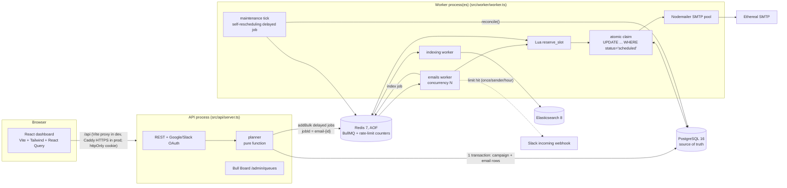

# ReachInbox Email Scheduler

A production-style email scheduler and dashboard. Express + BullMQ + Redis + PostgreSQL send through Ethereal SMTP. The React dashboard matches the provided Figma.

- **No cron, anywhere.** Every email is one BullMQ **delayed job**. Background maintenance is a self-rescheduling delayed job.
- **Survives restarts.** Postgres is the source of truth and Redis runs with AOF. A reconciler rebuilds Redis from Postgres if it is ever lost.
- **Never sends twice.** An atomic Postgres claim guards every send, so two workers can never both send the same email. The crash policy is at-most-once (explained below).
- **Rate limited across workers.** The per-sender hourly cap and minimum spacing are enforced by one atomic Redis Lua script. Overflow is deferred to the next hour, never dropped.
- **Searchable** through Elasticsearch, with a **live queue dashboard** (Bull Board), **real Google login**, and **real Slack OAuth** that posts a message when a sender hits its limit.

## Live demo

**https://garvv-scheduler.duckdns.org**

- **Sign in:** click **Sign up** on the login card and create an account with any email and a password (8+ characters), or use **Login with Google** (the Google app is published, so any Google account works).
- **Try it:** Compose → upload [`samples/leads.csv`](samples/leads.csv) (15 valid addresses, plus duplicates and an invalid row to show the counters) → **Send Later** → watch the emails move from **Scheduled** to **Sent**. Each sent row links to its Ethereal preview.
- **Slack:** profile menu → **Slack → Connect Slack** to receive the rate-limit alerts in your own workspace.
- **Queue dashboard (Bull Board):** once signed in, profile menu → **Queue dashboard**, or open https://garvv-scheduler.duckdns.org/admin/queues. No extra password; it's read-only.
- Hosted on one Google Cloud VM (e2-medium, Mumbai) with Docker Compose and Caddy (automatic Let's Encrypt HTTPS). The deployment is checked by `deploy/smoke-test.sh` (26/26 passing against the live URL). See [Deploying it live](#deploying-it-live-one-server-docker).

## Contents

[Features implemented](#features-implemented) · [1. Architecture](#1-architecture) · [2. Setup: backend, frontend, Ethereal, env](#2-setup-about-5-commands) · [Deploying it live](#deploying-it-live-one-server-docker) · [3. Scheduling](#3-how-scheduling-works-and-why-there-is-no-cron) · [4. Persistence on restart](#4-persistence-and-restart-behavior) · [5. Idempotency](#5-idempotency-why-an-email-is-never-sent-twice) · [6. Rate limiting and concurrency](#6-rate-limiting-and-concurrency) · [7. Load](#7-behavior-under-load-1000-emails-limit-exceeded) · [8. Elasticsearch](#8-elasticsearch) · [9. Slack](#9-slack-real-oauth-and-a-real-message-on-limit-hit) · [10. Google login](#10-google-login-real-oauth) · [11. Bull Board](#11-bull-board) · [12. API](#12-api-reference) · [13. Frontend](#13-frontend) · [14. Testing](#14-testing-and-verification) · [15. Security](#15-security-checklist) · [16. Next steps](#16-known-limitations-and-what-id-do-next) · [17. Alternatives](#17-alternatives-considered) · [18. Assumptions and trade-offs](#18-assumptions-and-shortcuts)

---

## Features implemented

Each row maps an assignment requirement to where it lives and how it was verified.

### Backend

| Requirement | Implementation | Where | Verified by |
|---|---|---|---|
| Accept scheduling requests via API | `POST /api/campaigns`: zod validation, recipient normalization and de-duplication, `Idempotency-Key` | `backend/src/modules/campaigns` | integration test (c) |
| Store in a relational DB | PostgreSQL 16 + Prisma; one transaction per campaign plus its email rows | `backend/prisma/schema.prisma` | all tests |
| **Scheduler** with BullMQ delayed jobs, no cron | One delayed job per email, `jobId = email-{id}`; pure planner spreads emails across hours; maintenance is a self-rescheduling delayed job | `backend/src/scheduler/planner.ts`, `backend/src/worker/` | planner unit tests, `e2e:restart` |
| Multiple senders via Ethereal SMTP | Pool of `SENDER_COUNT` Ethereal accounts created at boot; round-robin or a chosen sender; pooled SMTP per sender | `backend/src/modules/senders`, `backend/src/mail` | live sends with Ethereal preview links |
| **Persistence** across restarts | Postgres as source of truth, Redis AOF + `noeviction`, `reconcile()` rebuilds jobs from Postgres after data loss | `backend/src/worker/reconcile.ts`, `docker-compose.yml` | `e2e:restart`, `e2e:redis` |
| **No duplicate sends** (idempotency) | API idempotency key, deterministic job IDs, atomic `UPDATE … WHERE status='scheduled'` claim, at-most-once crash policy | `backend/src/worker/emailState.ts` | integration tests (a), (b), (c); `e2e:two-workers` |
| **Worker concurrency** | `WORKER_CONCURRENCY` (default 5) per process; any number of worker processes | `backend/src/worker/worker.ts` | `e2e:two-workers` |
| **Minimum delay between sends** | Per-sender slot reservation in Redis (default 2 s), holds across processes | `backend/src/ratelimit/reserve_slot.lua` | integration test (d), `e2e:two-workers` |
| **Emails per hour** (per sender, configurable) | `MAX_EMAILS_PER_HOUR_PER_SENDER` (default 200) plus the campaign's hourly limit; atomic Redis counters per hour window | `backend/src/ratelimit/` | integration tests (d), (e); `load-test` |
| Limit reached: defer, don't drop | Job moved to the next hour window with an order-preserving offset; status stays `scheduled` | `backend/src/worker/processEmail.ts` | integration test (e), `load-test` |
| **Slack notification** on limit hit | Real Slack OAuth (`incoming-webhook`), encrypted webhook per user, one message per sender per hour, works after a later connect | `backend/src/modules/slack` | integration test (f), `slack:demo` (live message) |
| Behavior under load (1000+ emails) | Chunked bulk enqueue; planner (tier 1) and Redis guard (tier 2) | §7 | `load-test` (1,120 emails, cap never exceeded) |
| Searchable via Elasticsearch | Async indexing queue, upsert by email ID, user-scoped search, `es:reindex` | `backend/src/modules/search` | UI search, `es:reindex` |
| Live BullMQ dashboard | Bull Board at `/admin/queues`, open to any signed-in user, read-only | `backend/src/api/bullBoard.ts` | integration test (h), smoke test |

### Frontend

| Requirement | Implementation | Where |
|---|---|---|
| Real Google OAuth login | Backend authorization-code flow, httpOnly session cookie, redirect to the dashboard | `frontend/src/features/auth` |
| Login for anyone with the link | Email + password sign-up and login on the Figma login card (scrypt-hashed passwords) | `frontend/src/features/auth`, `backend/src/modules/auth` |
| Header with name, email, avatar and logout | Sidebar profile card (initials fallback) with a menu: Slack, Queue dashboard, Logout | `frontend/src/layout` |
| Dashboard with Scheduled and Sent tabs | Keyboard-accessible tabs with live counts; tab, page, search and filter stored in the URL | `frontend/src/features/emails` |
| "Compose New Email" | Compose page: subject, body, start time (Send Later popover), delay, hourly limit, sender | `frontend/src/features/compose` |
| CSV/TXT lead upload with address count | Parsed in the browser with PapaParse, every column scanned; shows detected, duplicate and invalid counts | `frontend/src/features/compose/extractEmails.ts` |
| Scheduled table: email, subject, scheduled time, status | Generic typed `Table`; orange time chip, "Sending", deferred tooltip | `frontend/src/features/emails/EmailTable.tsx` |
| Sent table: email, subject, sent time, status | Sent and Failed chips, failure reason tooltip, Ethereal preview link | same |
| Loading, empty and error states | Skeleton rows, empty states with a call to action, error state with retry, toasts | `frontend/src/components/ui` |
| Matches the Figma | Login, inbox lists, email view, compose with chips and Send Later; tokens in `src/index.css` | §13 |
| Reusable components, DRY, typed | 15 UI components, one table for all lists, typed API client and response types | `frontend/src/components/ui`, `frontend/src/types` |
| Extras | Elasticsearch search box with status filter, email detail page, Slack connect/disconnect/test | — |

---

## 1. Architecture



| | Role |
|---|---|
| **PostgreSQL** | Durable truth: what must happen and what happened (`campaigns`, `emails`, `senders`, `users`, `slack_connections`, `notification_log`). |
| **Redis / BullMQ** | Execution engine: timers (delayed jobs), job locks, retries, rate-limit counters, OAuth state nonces. Everything in it can be rebuilt from Postgres. |
| **Elasticsearch** | Read model for search, fed asynchronously. Never on the send path. |

Two separate entrypoints: `dev:api` and `dev:worker`. You can run as many workers as you like. In production the API also serves the built React app, so the site, API and OAuth callbacks share one origin.

---

## 2. Setup (about 5 commands)

Requirements: Node 20+, Docker, and internet access (Ethereal accounts are created at runtime).

```bash
npm install
```
```bash
cp .env.example .env    # then fill the values (see table below)
```
```bash
docker compose up -d    # postgres:16, redis:7 (AOF), elasticsearch:8
```
```bash
npm run db:migrate && npm run db:seed
```
**Run the backend** (Express API + BullMQ worker, two processes):
```bash
npm run dev:api        # terminal 1  -> http://localhost:4000
npm run dev:worker     # terminal 2  (start more of these to scale out)
```
**Run the frontend:**
```bash
npm run dev:web        # terminal 3  -> http://localhost:5173 (proxies /api to :4000)
```

Open http://localhost:5173 and sign up with an email and password (Google login works once its credentials are in `.env`).

> Host ports are **55432** (Postgres) and **56379** (Redis) so they don't clash with other local instances. Elasticsearch uses 9200.

**Ethereal Email:** nothing to configure. On first boot, the API and worker create `SENDER_COUNT` Ethereal accounts through the same endpoint as `nodemailer.createTestAccount()` and store them in `senders`. Only missing accounts are created, and a Redis lock prevents a boot race. Every sent email has an **Ethereal preview link**, shown in the Sent list and on the email page. To browse a sender's whole mailbox, print the logins and sign in at https://ethereal.email/login:
```bash
npm run ethereal -w backend
```

### Environment variables

| Variable | Default | Notes |
|---|---|---|
| `PORT` | 4000 | API port |
| `FRONTEND_URL` | http://localhost:5173 | CORS origin and post-login redirects |
| `PUBLIC_BACKEND_URL` | — | public **HTTPS** URL of the API, used for the Slack callback (a tunnel locally; the site URL in production) |
| `DATABASE_URL`, `REDIS_URL`, `ELASTICSEARCH_URL` | see `.env.example` | match `docker-compose.yml` |
| `JWT_SECRET` | — | `openssl rand -hex 32` |
| `ENCRYPTION_KEY` | — | 64 hex chars, `openssl rand -hex 32` (AES-256-GCM for Slack webhooks) |
| `GOOGLE_CLIENT_ID`, `GOOGLE_CLIENT_SECRET` | — | Google Cloud Console → Credentials → OAuth client (Web) |
| `GOOGLE_REDIRECT_URI` | http://localhost:4000/api/auth/google/callback | register exactly this URI |
| `SLACK_CLIENT_ID`, `SLACK_CLIENT_SECRET` | — | api.slack.com/apps → Basic Information |
| `BULL_BOARD_USER`, `BULL_BOARD_PASSWORD` | — | optional: also allow HTTP Basic auth to `/admin/queues` (for curl/ops); signed-in users never need it |
| `WORKER_CONCURRENCY` | **5** | jobs in flight per worker process |
| `MIN_DELAY_BETWEEN_EMAILS_MS` | **2000** | minimum spacing between two sends **of the same sender** |
| `MAX_EMAILS_PER_HOUR_PER_SENDER` | **200** | global per-sender cap per UTC hour |
| `SENDING_LEASE_MS` | 300000 | after this, an email stuck in `sending` is marked failed (never resent) |
| `MAX_RECIPIENTS_PER_CAMPAIGN` | 10000 | |
| `SENDER_COUNT` | 3 | size of the Ethereal sender pool |
| `SENDER_DOMAIN` | scheduler.local | used in deterministic `Message-ID: <email-{id}@domain>` |
| `MAIL_DRY_RUN` | false | load testing only: build messages without opening SMTP connections |

Configuration is validated with zod at startup, and the process exits with a clear list of problems. Missing Google or Slack credentials don't stop the app. Those flows return `NOT_CONFIGURED` with an explanation, and the login page shows a readable message.

### Deploying it live (one server, Docker)

The production stack (`docker-compose.prod.yml`) runs everything in containers on one server: Postgres, Redis (AOF), Elasticsearch, the API (which also serves the built website), the worker, and **Caddy** for automatic HTTPS. Only ports 80/443 are reachable from outside; the databases have no published ports. It works on any Ubuntu 22.04/24.04 server with about 4 GB of RAM, x86 or ARM. The live demo runs on a **Google Cloud e2-medium** (2 vCPU / 4 GB, about 2 GB used); Oracle Cloud's Ampere A1 works too.

1. **Create the server** with **Ubuntu 24.04** and a public IP, and add your SSH public key.
   - *Google Cloud:* Compute Engine → Create instance → e2-medium, 30 GB disk, tick **Allow HTTP/HTTPS traffic**, reserve a static external IP, add the key under Security → Manage access (user `ubuntu`).
   - *Oracle Cloud:* VM.Standard.A1.Flex in a **public** subnet; add an ingress rule for TCP `80,443` from `0.0.0.0/0` to the subnet's Security List.
2. **Pick a hostname** that points at the IP, for example a free DuckDNS subdomain (`yourname.duckdns.org`) or your own domain's A record. Google sign-in needs a real hostname, not a bare IP.
3. **Prepare the server.** It installs Docker, opens 80/443 in the host firewall (Oracle images reject them by default), keeps IP forwarding on and matches Docker's MTU to the NIC (Google Cloud images disable forwarding and use MTU 1460, which otherwise cuts containers off from the internet), sets `vm.max_map_count` for Elasticsearch, and checks outbound access to Ethereal SMTP (587), Slack and Google:
   ```bash
   ssh -i <key> ubuntu@<ip> 'bash -s' < deploy/server-setup.sh
   ```
4. **Create `.env.production`** (git-ignored) from `.env.production.example`. Set `SITE_ADDRESS` to the hostname, the three `https://` URLs, fresh secrets (`openssl rand -hex 32`), and the Google/Slack IDs.
5. **Deploy** (also how you ship updates later):
   ```bash
   deploy/deploy.sh ubuntu@<ip> <key>
   ```
   It uploads the committed code and `.env.production`, builds the image on the server, runs migrations, starts everything, and prints the live URL once `/health` is green.
6. **Point the OAuth apps at the live URL:**
   - Google client: add `https://<host>` as a JavaScript origin and `https://<host>/api/auth/google/callback` as a redirect URI, fill in **Branding**, then **Publish app** (§10).
   - Slack app: add `https://<host>/api/slack/callback` as a redirect URL.

7. **Verify the live site** from your machine (26 checks; it creates one throwaway account and sends 3 emails to example.com):
   ```bash
   deploy/smoke-test.sh https://<host>
   ```

Data lives in Docker volumes, so redeploys and reboots keep it. Every container uses `restart: unless-stopped`.

**Before deploying, the production stack can be tested locally:**
```bash
ENV_FILE=.env.prodtest deploy/prod-e2e.sh
```
This uses `SITE_ADDRESS=localhost` and `https://localhost:8443` URLs; Caddy issues a local certificate. It runs the smoke test, then kills the API and worker mid-schedule, restarts Redis, stops and starts every container (a reboot), runs two workers, takes Elasticsearch down, and forces the hourly limit. Each step checks that every email is sent exactly once and nothing is dropped. Last run: every check passed.

---

## 3. How scheduling works (and why there is no cron)

1. `POST /api/campaigns` validates and normalizes the recipients: trim, lower-case, regex check, de-duplicate.
2. The **planner** (`src/scheduler/planner.ts`, a pure, unit-tested function) assigns senders round-robin. It spaces each sender's emails by the effective delay and caps them per UTC hour window, overflowing into the next window. Every email gets a `scheduled_at`.
3. **One transaction** inserts the campaign and every email row with `queued=false`.
4. **After commit**, `queue.addBulk` runs in chunks of 500. Each email becomes one delayed job with `delay = scheduled_at − now`, `jobId = email-{emailId}`, and payload `{ emailId }` only. The rows are then marked `queued=true`. Scheduling 1,000 emails takes about 250 ms.
5. When the job comes due, the worker **reloads the row from Postgres** (job data can't go stale), reserves a rate-limit slot, claims the row, and sends.

Rejected alternatives: cron or DB polling (banned, and wasteful); `setTimeout` (lost on restart); one big batch job (no per-email retries or visibility); BullMQ repeatable jobs or job schedulers (cron-like); Kafka/RabbitMQ/SQS (not needed here).

---

## 4. Persistence and restart behavior

| Failure | What happens |
|---|---|
| API and/or worker killed (`SIGKILL`) | Delayed jobs live in Redis and rows in Postgres. On restart, the worker picks the jobs up and sends at the right time. Verified by `e2e:restart`. |
| Redis restarted | `appendonly yes`, `appendfsync everysec`, `noeviction`, plus a named volume. Delayed jobs survive. Verified by `e2e:redis`, part 1. |
| Redis data lost (`FLUSHALL`, new instance) | `reconcile()` sees the `sys:redis_epoch` sentinel is missing and re-enqueues **every** `scheduled` row from Postgres. Deterministic job IDs make this idempotent. Verified by `e2e:redis`, part 2. |
| API crashed between commit and enqueue | Rows stay `queued=false`, and `reconcile()` enqueues them. |
| A job died without updating its row (infra error) | `reconcile()` finds overdue `scheduled` rows whose job is missing, failed or completed, and re-enqueues them. |
| Worker died mid-send | The row stays `sending`. After `SENDING_LEASE_MS` it becomes `failed / interrupted_unconfirmed` and is **never resent** (see §5). |

**When does reconciliation run, without cron?**
- At worker startup.
- On every Redis reconnect.
- On a **self-rescheduling delayed job** in the `maintenance` queue. Each tick runs `reconcile()` and then adds the next tick, 60 s later.

The tick's job ID is `maintenance-tick-<minute>`, derived from its target minute. Every API, worker or health probe that tries to schedule "the next tick" therefore gets the same ID, and BullMQ de-duplicates it, so exactly one pending tick exists per minute. (A single fixed ID can't be re-added while the current tick is still active, so the minute bucket is what makes the chain safe.) A wipe that deletes the chain is healed by worker boot, Redis reconnect, API boot, or any `GET /health` probe.

Graceful shutdown on `SIGTERM`/`SIGINT`: `worker.close()` waits for active jobs, then queues, Redis, Prisma, SMTP pools and the ES client are closed. Worker settings: `lockDuration: 60s`, `maxStalledCount: 1`, plus `error`/`failed`/`stalled` listeners on every worker and queue.

---

## 5. Idempotency: why an email is never sent twice

The protection is layered:

1. **API:** the frontend sends an `Idempotency-Key` (one UUID per Compose page visit, reused on retries). `UNIQUE(user_id, idempotency_key)` means a replay returns the same campaign with **HTTP 200** and creates nothing. Concurrent duplicates race on the constraint, and the loser returns the winner's campaign. `UNIQUE(campaign_id, recipient_email)` blocks duplicate rows.
2. **Queue:** `jobId = email-{id}`, so adding the same job twice is a no-op. Finished jobs are kept (`removeOnComplete: {age: 1 day, count: 5000}`, never `true`). Correctness still never depends on Redis keeping them.
3. **Execution, the real guard.** Right before sending, the worker runs one statement:
   ```sql
   UPDATE emails SET status='sending', sending_started_at=now(), attempt_count=attempt_count+1
   WHERE id=$1 AND status='scheduled' RETURNING ...
   ```
   Zero rows returned means someone else owns the email or it's already done, so the worker skips it. Two workers can never both win. A stalled job that BullMQ re-delivers also loses the claim.
4. **State machine:** `scheduled → sending → sent | failed`, plus `sending → scheduled` only after a *definitely-not-sent* error. Every transition is a guarded `UPDATE ... WHERE status = <expected>`.

**The honest gap (at-most-once).** If a worker dies after claiming but before recording the result, we can't know whether the SMTP server accepted the message. Exactly-once delivery across a database and SMTP is impossible, so we don't claim it. Our policy is **never auto-resend**. The row becomes `failed` with `failure_reason='interrupted_unconfirmed'` once the lease expires. A missed cold email is better than a double send. Each message also carries a deterministic `Message-ID: <email-{id}@SENDER_DOMAIN>`, which is stored, so downstream systems can de-duplicate.

**SMTP errors are classified** (`src/mail/classifyError.ts`, unit-tested):

| Class | Examples | Action |
|---|---|---|
| permanent | 5xx, `EENVELOPE` | `failed/permanent`, `UnrecoverableError` (no retry) |
| transient, definitely not sent | 4xx; `ECONNECTION`/`ETIMEDOUT`/`EDNS` during CONN/EHLO/AUTH/MAIL/RCPT | back to `scheduled`, BullMQ retry (3 attempts, exponential from 30 s); after the last attempt, `failed/retries_exhausted` |
| ambiguous | socket drop or timeout during or after `DATA` | `failed/delivery_unconfirmed`, no retry |

---

## 6. Rate limiting and concurrency

**Chosen values:** **2 seconds minimum between sends of the same sender**, **200 emails/hour/sender**, **worker concurrency 5**. All are configurable through env. The Compose form's "Delay between 2 emails" and "Hourly Limit" (per sender, for that campaign) are clamped server-side:

```
effective_delay  = max(MIN_DELAY_BETWEEN_EMAILS_MS, campaign.delay)
effective_hourly = min(MAX_EMAILS_PER_HOUR_PER_SENDER, campaign.hourly)
```

The API returns the effective values, and the UI shows a toast when it clamped anything.

### Two tiers

- **Tier 1, the planner** (at schedule time, pure arithmetic). It places most emails in a window that already has room, so most jobs never get deferred.
- **Tier 2, the runtime guard** (authoritative, Redis, atomic, safe across workers). Every job passes through `src/ratelimit/reserve_slot.lua` before sending. It catches what the planner can't see: other campaigns on the same sender, the global per-sender cap, many worker processes, and backlog bursts after downtime.

```lua
slot = max(now, GET rl:next:{sender})             -- earliest allowed send time for this sender
win  = floor(slot / HOUR)                         -- window derived from the SLOT, not from now
if GET rl:cnt:{sender}:{win}            >= senderCap   -> return LIMIT, (win+1)*HOUR, "sender"
if GET rl:cnt:{sender}:{campaign}:{win} >= campaignCap -> return LIMIT, (win+1)*HOUR, "campaign"
INCR both counters (PEXPIRE 2h); SET rl:next:{sender} = slot + delay
return OK, slot
```

- **OK:** the worker waits until `slot`, then claims and sends. If the wait exceeds 60 s, the job goes back to the delayed set instead of holding a concurrency slot. The minimum delay is a **per-sender slot reservation**, so it holds across any number of worker processes (`e2e:two-workers` measured a ~2,000 ms minimum gap between two processes).
- **LIMIT:** the email is **deferred, not failed.** `scheduled_at = windowEnd + (planned_index % 1000) ms`, `deferred_count++`, status stays `scheduled`, then `job.moveToDelayed()` + `DelayedError`. The small offset keeps campaign order within the new window, and the per-sender slot reservation serializes actual sends in arrival order. A Slack notification is triggered (§9).

**Trade-offs and limits (stated honestly):**
- **Fixed UTC-hour windows.** In theory, up to 2× the cap could go out across a window boundary. In practice the per-sender minimum delay bounds the burst rate, so it can't spike. Rejected alternatives: sliding-window logs (memory-heavy), token buckets (harder to reason about "per hour"), and BullMQ's `limiter` (queue-wide, not per sender; per-key groups are a paid BullMQ Pro feature).
- **Counters count attempts.** A retried email consumes a slot again.
- **Order** is preserved within a campaign "as much as possible". Different campaigns sharing a sender compete in arrival order.
- Assumes a **single Redis node**. On Redis Cluster the keys would need hash tags (`{sender}`) so the script's keys share a slot.
- If Redis data is lost, that hour's counters are lost too, so the cap could be exceeded once in that hour.

**Concurrency safety:** no shared in-memory state is relied on. Correctness comes from the DB claim, the Lua script and guarded updates. Running several `npm run dev:worker` processes is safe; `e2e:two-workers` gave 30/30 sent once, split 15/15.

---

## 7. Behavior under load (1000+ emails, limit exceeded)

`npm run load-test -w backend` schedules **1,000 recipients** (3 senders, cap **50/hour/sender**). A second, overlapping campaign of 120 recipients on the same senders creates overflow the first plan couldn't foresee. It uses its own senders, and a dry-run transport so nothing hits SMTP. Real output:

```
scheduled 1000 emails in 241 ms (planner + 1 tx + bulk enqueue); effective { delayMs: 200, hourlyLimit: 50 }
second campaign: 120 emails in 50 ms
status counts: { sent: 150, scheduled: 970 }
sends per sender per UTC hour window:
  load1-…  2026-11-05T14:00Z  50
  load2-…  2026-11-05T14:00Z  50
  load3-…  2026-11-05T14:00Z  50
remaining scheduled emails by future hour: 15:00Z 270 · 16:00Z 150 · 17:00Z 150 · 18:00Z 150 · 19:00Z 150 · 20:00Z 100
emails deferred at runtime by the Redis guard: 120
PASS: no email lost (1120/1120) · every email sent or scheduled · none failed
PASS: no sender exceeded 50/hour in any window (max 50) · no email claimed twice
PASS: overflow the planner could not foresee was deferred by the runtime guard, not dropped
```

What happens:
- The API does one transaction plus chunked `addBulk`.
- The planner spreads the emails across hours per sender.
- The Lua guard defers whatever doesn't fit, and the delay gate serializes each sender.
- Only `WORKER_CONCURRENCY` jobs run per process.
- Redis memory stays bounded by `removeOnComplete`/`removeOnFail` and by counters that expire after 2 h.
- After downtime, overdue jobs all become due at once. The guard turns that burst into "this hour's remaining budget now, the rest deferred", so there is no spike.

---

## 8. Elasticsearch

- Index `emails` (strict mapping): `recipient_email` is `search_as_you_type` with a `keyword` subfield; `subject` and `body` are `text`; `status`, `user_id`, `campaign_id`, `sender_email` are `keyword`; `scheduled_at` and `processed_at` are `date`.
- **No dual writes in the request path.** Every change to an email enqueues an `indexing` job (`jobId idx-{emailId}-{updatedAt}`, 5 attempts with backoff). The indexer reloads the **latest** row and upserts it with `_id = emailId`, so the last state wins even if jobs arrive out of order.
- If ES is down, **sending is never blocked**; index jobs retry. Search is **eventually consistent** (typically under a second).
- `GET /api/emails/search?q=&status=&page=&pageSize=` always filters by the logged-in `user_id`. The dashboard search box uses it on both tabs (debounced), and the filter icon narrows by status.
- `npm run es:reindex` rebuilds the whole index from Postgres, which proves Postgres is the source of truth.

Postgres full-text search was rejected because the assignment requires ES. Synchronous indexing was rejected because it couples availability.

---

## 9. Slack: real OAuth and a real message on limit hit

**Flow:**
1. `GET /api/slack/connect` stores a random `state` in Redis (`slack:state:{state}` → userId, 10-min TTL) and redirects to `slack.com/oauth/v2/authorize` with `scope=incoming-webhook`.
2. Slack redirects to `${PUBLIC_BACKEND_URL}/api/slack/callback`. That arrives on the tunnel domain, so there's no localhost cookie; the one-time `state` (consumed with `GETDEL`) identifies the user.
3. The code is exchanged at `oauth.v2.access`. `incoming_webhook.url` is stored **AES-256-GCM encrypted** and never logged.
4. The browser is redirected to `/dashboard?slack=connected`.

**Notification:**
- On a `LIMIT` result, the worker inserts into `notification_log` with `ON CONFLICT DO NOTHING`, keyed by `(user, sender, hour window)`. Only if the insert wins does it look up the user's connection **at that moment** (no caching, so connecting later works without a redeploy) and POST the message: sender, cap, window end in IST and UTC, and the number deferred so far.
- No connection means it skips silently and writes no log row, so connecting later in the same hour still notifies.
- 404/410/`no_service`/`channel_is_archived` deletes the connection.
- Slack errors never reach the email job. The HTTP status is recorded in `notification_log.status`.

The dashboard's profile menu has **Slack**: connect, reconnect, disconnect, send test. Endpoints: `GET /api/slack/status`, `DELETE /api/slack/disconnect`, `POST /api/slack/test`. The integration test `slackNotify.test.ts` checks the real HTTP POST against a local webhook: one message across 5 concurrent limit hits, silence without a connection, and cleanup of a revoked webhook.

### Setup (needs your credentials)
On the live site there's no tunnel: `PUBLIC_BACKEND_URL` is the site URL and the Slack redirect URL is `https://<host>/api/slack/callback`. Locally:
1. Start a tunnel to the API: `cloudflared tunnel --url http://localhost:4000` (or `ngrok http 4000`). Put the `https://…` URL in `PUBLIC_BACKEND_URL`.
2. At https://api.slack.com/apps, choose **Create New App → From scratch**.
3. Under **OAuth & Permissions → Redirect URLs**, add `${PUBLIC_BACKEND_URL}/api/slack/callback`.
4. Under **Bot Token Scopes**, add `incoming-webhook`. Copy the Client ID and Secret into `.env`, then restart the API.
5. In the dashboard, open the profile menu → **Slack → Connect Slack**, pick a channel, and Allow.
6. Stop `npm run dev:worker`, then run the live demo (it starts its own worker with a per-sender cap of 3):
   ```bash
   npm run slack:demo -w backend -- you@gmail.com
   ```
   A single campaign never trips the limit at runtime, because the planner already spreads it across hours. The alert fires when work the planner couldn't foresee lands on the same sender. The demo creates exactly that: two campaigns of 3 emails each, sharing one sender. The sender's hourly budget runs out, the Redis guard returns `LIMIT`, the message appears in your channel, and the overflow is deferred to the next hour. It prints the Slack HTTP status from `notification_log`. Restart `dev:worker` afterwards; it sends the deferred emails when their hour comes.

> The tunnel URL changes each time a quick tunnel restarts; update `PUBLIC_BACKEND_URL` and the Slack redirect URL together.

---

## 10. Google login (real OAuth)

The flow is a backend-driven authorization-code flow using `google-auth-library`:
1. `/api/auth/google` sets a short-lived httpOnly `state` cookie and redirects to Google (`openid email profile`).
2. `/api/auth/google/callback` checks `state` (timing-safe) and exchanges the code.
3. It **verifies the ID token** (signature + audience) and upserts the user by `google_sub`.
4. It sets a **7-day HS256 JWT in an httpOnly, SameSite=Lax cookie** (`Secure` in production) and redirects to `/dashboard`.

Tokens never touch `localStorage`. In dev, Vite proxies `/api` so the cookie is same-origin. CORS is still restricted to `FRONTEND_URL` with credentials.

**Setup (local):** in Google Cloud Console, go to APIs & Services → OAuth consent screen (External, add yourself as a test user), then Credentials → **Create OAuth client ID** (Web application). Add the authorized redirect URI `http://localhost:4000/api/auth/google/callback`. Put the ID and secret in `.env` and restart the API.

Trade-off: a stateless JWT can't be revoked server-side before it expires (logout clears the cookie). A Redis session store would add revocation at the cost of a lookup per request.

### Email + password (so anyone with the link can sign in)

Google only lets listed test users in while an OAuth app is in "Testing", and a reviewer may not want to use Google at all. So the hosted app also offers **Sign up / Login with email and password** on the same login card, and reviewers can create an account in seconds.
- `POST /api/auth/register {name, email, password}` (password at least 8 characters) and `POST /api/auth/login {email, password}`. Both set the same httpOnly session cookie as Google login and are rate-limited.
- Passwords are stored only as **salted scrypt hashes** (`backend/src/lib/password.ts`, Node's built-in crypto). Login compares in constant time, and a failed login looks the same whether the email exists or not.
- A Google-only account can't be taken over by registering its email with a password. If someone who registered with a password later uses Google with the same verified email, the Google identity is linked to their existing account.

To let **any Google account** sign in too, fill in Google Auth Platform → **Branding** (app name, support email, homepage `https://<your-domain>`, privacy policy `https://<your-domain>/privacy`, authorized domain), then **Audience → Publish app**. The app requests only `openid email profile`, which doesn't need Google's verification review. The live demo's Google app is published this way.

---

## 11. Bull Board

The live queue dashboard is at **http://localhost:4000/admin/queues** locally and `https://<host>/admin/queues` when deployed (also reachable from the profile menu → *Queue dashboard*, through the Vite proxy). It shows the `emails`, `indexing` and `maintenance` queues: delayed jobs with their run times, active jobs, retries and failures. Access uses the normal site login, so reviewers need no extra password:
- **Any signed-in user** can open it. Signed-out browsers are redirected to the login page, and signed-out API calls get 401.
- It runs in **read-only mode**: jobs can be inspected but not retried, promoted, cleaned, paused or deleted (checked by integration test (h)).
- Jobs carry only `{ emailId }`, so no addresses or message content are shown. The one exception is a failed job's SMTP error text, which can quote the rejected address; with Ethereal this practically never happens.
- Optional HTTP Basic auth (`BULL_BOARD_USER`/`BULL_BOARD_PASSWORD`) also works, for scripts.

Trade-off: the board shows the shared queues, not just your own jobs. Bull Board has no per-user filtering, and read-only mode plus ID-only job data keeps that safe.

---

## 12. API reference

All JSON. Errors use `{ "error": { "code", "message", "details?" } }`. Every route except auth, the Slack callback and health requires the session cookie, and every query is scoped to the user.

| Method | Path | Description |
|---|---|---|
| GET | `/health` (also `/api/health`) | Postgres / Redis / ES checks (503 if Postgres or Redis is down) |
| GET | `/api/auth/google` · `/api/auth/google/callback` | Google OAuth |
| POST | `/api/auth/register` · `/api/auth/login` | email + password; body `{name, email, password}` / `{email, password}`; sets the session cookie |
| GET | `/api/auth/me` | `{id, name, email, avatarUrl}` |
| POST | `/api/auth/logout` | clears the cookie |
| POST | `/api/campaigns` | header `Idempotency-Key`; body `{subject, body, recipients[], startAt, delayMs, hourlyLimit, senderId?}`. **201** `{campaign, effective, clamped, scheduledCount, invalidCount, duplicatesRemoved, firstScheduledAt, lastScheduledAt}`, or **200** on replay |
| GET | `/api/emails/scheduled?page&pageSize&status` | `scheduled` + `sending`, ordered by `scheduled_at` |
| GET | `/api/emails/sent?page&pageSize&status` | `sent` + `failed`, ordered by `processed_at DESC` |
| GET | `/api/emails/search?q&status&page&pageSize` | Elasticsearch; `status` = `scheduled`/`sent` (tab group) or a single status |
| GET | `/api/emails/:id` | full email for the detail page |
| GET | `/api/senders` | sender pool (no credentials) |
| GET | `/api/slack/connect` · `/api/slack/callback` | Slack OAuth |
| GET / DELETE / POST | `/api/slack/status` · `/api/slack/disconnect` · `/api/slack/test` | |

Pagination is offset/limit with `{items, page, pageSize, total, totalPages}`; `pageSize` is at most 100.

---

## 13. Frontend

Vite + React 18 + TypeScript (strict) + Tailwind 4, React Router, TanStack Query, PapaParse, react-hot-toast, lucide-react. There's no component library.

- **Matches the Figma** (design tokens for colors, type, radii and shadows live in `frontend/src/index.css`):
  - Login card.
  - Sidebar with "ONB", profile card, Compose and Scheduled/Sent counts.
  - Search pill with filter and refresh.
  - List rows: `To:`, orange time chip or grey "Sent" chip, bold subject, preview, star.
  - Email view.
  - Compose page: From, To chips with `+N` and **Upload List**, Subject, Delay, Hourly Limit, editor, and the **Send Later** popover with presets.
- **Compose:**
  - CSV/TXT files are parsed **in the browser**, every column scanned. Shows "N email addresses detected", duplicates removed and invalid skipped.
  - Files can be dropped anywhere on the To row (2 MB, `.csv`/`.txt`), or addresses typed or pasted.
  - Send Later defaults to now + 5 min and shows your timezone.
  - The button is disabled until the form is valid and shows a spinner while sending.
  - The idempotency key is generated once per page visit.
  - A toast confirms success, with any clamping notice.
- **Lists:**
  - Tab, page, search and filter all live in the URL.
  - Loading skeletons, empty states, an error state with retry, and pagination.
  - Auto-refresh every **5 s** through React Query polling. WebSockets/SSE would be over-engineering for this; polling is simple and a few seconds of latency is fine.
  - Failed rows show the reason in a tooltip; sent emails link to the Ethereal preview.
- **Reusable UI** in `src/components/ui`: Button, Input, Textarea, Modal (focus trap, Esc, focus restore), Tabs (ARIA, arrow keys), Table (generic, typed columns), Badge, Spinner, Skeleton, EmptyState, ErrorState, Avatar (initials fallback), FileDropzone, Pagination, StarButton.
- Feature code lives in `src/features/{auth,emails,compose,slack}`, with a typed fetch wrapper (`src/lib/api.ts`: `credentials: 'include'`, central errors, global 401 → `/login`) and all API types in `src/types/api.ts`.
- Interpretations: the login card's email/password form is a working **Login / Sign up** (see §10), so anyone with the link can use the hosted app. The editor's formatting buttons are drawn but disabled (emails are plain text plus an auto-generated HTML part); undo/redo work. The paperclip (attachments) is disabled. "From" defaults to round-robin across the pool, or one sender can be chosen.

---

## 14. Testing and verification

```bash
npm test                                   # unit: backend 30 + frontend 5
npm run test:integration -w backend        # needs docker compose services
npm run typecheck && npm run lint          # both packages, zero errors
```

**Unit tests:**
- Planner: order, cap per window, spacing, 1000 × 50 × 3 spread, past start clamped.
- AES-GCM round-trip and tamper detection.
- SMTP error classification.
- State-machine guards.
- Recipient normalization.
- Password hashing and verification.
- CSV/TXT email extraction (frontend).

**Integration tests** (real Postgres and Redis):

| | Test | Result |
|---|---|---|
| (a) | 20 concurrent claims of one email | exactly 1 wins |
| (b) | same job ID added three times | 1 job |
| (c) | same `Idempotency-Key` twice, plus a burst of 5 concurrent | 1 campaign each (201, then 200) |
| (d) | 200 concurrent `reserve_slot` calls with cap 50, over 8 connections | exactly 50 OK and 150 LIMIT; OK slots ≥ delay apart; campaign cap enforced separately |
| (e) | cap 2 with 5 due jobs | 2 sent, 3 deferred into the next window, 0 failed |
| (f) | Slack notify | one POST per sender per window under concurrency; silent without a connection; revoked webhook removed |
| (g) | email + password auth | register, duplicate email (409), wrong password (401), login, Google-only email protected |
| (h) | Bull Board access | signed out: redirect to login / 401; signed in: opens, every queue read-only, a pause request is refused |

**End-to-end scripts.** These spawn the real API and worker as child processes and SIGKILL them:

| Command | What it proves |
|---|---|
| `npm run e2e:restart -w backend` | 10 emails 2 min out; **SIGKILL API + worker**; restart → 10/10 sent, attempt_count = 1, none early, 10 distinct Message-IDs, one SMTP send per email in the logs |
| `npm run e2e:redis -w backend` | `docker compose restart redis` → delayed jobs survive (AOF) and send. Then **FLUSHALL** → reconcile re-enqueues from Postgres → all sent once |
| `npm run e2e:two-workers -w backend` | 2 worker processes, 30 emails → 30/30 sent exactly once, split 15/15, per-sender spacing held |
| `npm run load-test -w backend` | §7 |
| `npm run slack:demo -w backend -- you@gmail.com` | live Slack message (needs your workspace) |

Stop your own `dev:worker` before `load-test`; it runs its own dry-run worker and checks for others. The e2e scripts start their own API on port 4000, so stop `dev:api` first.

**Production stack:**

| Command | What it proves |
|---|---|
| `deploy/smoke-test.sh https://<host>` | 26 checks against a running deployment: pages, security headers, sign-up/login, read-only queue dashboard, OAuth redirects, schedule → send through Ethereal → search, per-user isolation. **26/26 against the live site.** |
| `ENV_FILE=.env.prodtest deploy/prod-e2e.sh` | local only: the same Docker stack under SIGKILL, Redis restart, full stop/start, two workers, Elasticsearch down and a forced hourly limit. **25/25.** |

---

## 15. Security checklist

- Helmet (CSP etc.).
- CORS restricted to `FRONTEND_URL` with credentials.
- zod validation on every input; 2 MB body cap.
- Parameterized queries only (Prisma and tagged `$queryRaw`).
- `express-rate-limit` on the auth and Slack routes.
- httpOnly session cookie.
- OAuth `state` checked: timing-safe cookie for Google, one-time Redis nonce for Slack.
- Every query scoped by `user_id`; another user's email returns 404.
- Slack webhook URLs encrypted at rest (AES-256-GCM) and never logged. Pino redacts credentials, cookies and webhooks; query strings (OAuth codes) are never logged.
- Bull Board only for signed-in users and read-only (optional Basic auth uses a timing-safe compare).
- Ethereal passwords are never returned by the API.
- Passwords stored as salted scrypt hashes, compared in constant time.
- `.env` and `.env.production` are git-ignored; in production only Caddy (80/443) is exposed, with HTTPS and HSTS.

---

## 16. Known limitations and what I'd do next

- **Sliding-window or GCRA limits** instead of fixed windows, if the boundary edge case matters.
- **Redis Cluster:** hash-tag the rate-limit keys (`rl:{sender}:…`) and use BullMQ queue-name hash tags.
- **Per-tenant senders** (users' own SMTP/OAuth mailboxes) instead of one global Ethereal pool.
- **Bounce, complaint and reply handling**, **unsubscribe** links and suppression lists, and per-domain throttling.
- **Observability:** Prometheus metrics (queue depth, send latency, deferrals), OpenTelemetry traces, alerting on stuck `sending` rows.
- **Cancel or pause** a campaign (`scheduled → cancelled` is already allowed by the state machine).
- Rich-text editing (TipTap) with HTML sanitization, and attachments.
- Session revocation (a server-side session store) and refresh rotation.
- SSE or WebSocket push instead of polling, if lists get large.

## 17. Alternatives considered

| Concern | Chosen | Alternatives and why not |
|---|---|---|
| Queue / timers | BullMQ delayed jobs | cron / DB polling (banned, wasteful); `setTimeout` (lost on restart); Kafka/RabbitMQ/SQS (no native per-message delay at this scale, more infra); BullMQ repeatables (cron-like) |
| Duplicate protection | DB atomic claim + deterministic job IDs | Redlock (unneeded; the DB claim is simpler and stronger); "exactly-once" (impossible across DB + SMTP) |
| Rate-limit state | Redis Lua (atomic) | Postgres counters (hot-path write amplification); BullMQ `limiter` (not per sender) |
| DB / ORM | PostgreSQL 16 + Prisma (+ raw SQL for atomic updates) | MySQL (no advantage); query builders (fine, but Prisma gives typed models + migrations) |
| Search | Elasticsearch via an async indexing queue | Postgres FTS (the assignment requires ES); synchronous indexing (couples availability) |
| Auth | Manual Google OAuth + JWT cookie | NextAuth/Passport/Firebase/Clerk (hide the flow); Redis sessions (not needed here) |
| Live UI | React Query polling (5 s) | WebSockets/SSE (more moving parts for little gain here) |

## 18. Assumptions and shortcuts

- The UI's "hourly limit" means emails per hour **per sender** for that campaign. It is capped by the global per-sender limit.
- Senders form a global pool of Ethereal accounts shared by all users. Limits are per sender, so they apply across users.
- Pinned versions: Prisma 6.19.3, BullMQ 5.81.5, ioredis 5.11.1, `@elastic/elasticsearch` 8.19.2 (server 8.19.2), Express 5.1, zod 4, Vitest 3.2.7, TypeScript 5.9.3, React 18.3.1, Vite 7.3.7, Tailwind 4.3.4. Newer majors existed (Prisma 7/8, BullMQ 6, ES client 9); I stayed on the line that matches ES 8 and is well proven.
- Ethereal accounts are created by calling the same endpoint `nodemailer.createTestAccount()` uses, because nodemailer caches one account per process and we need several distinct senders.
- Ethereal never delivers to real inboxes; every "sent" email is viewed through its Ethereal preview link. Swapping in a real SMTP provider only changes the transport config.
- Email + password login was added beyond the brief so reviewers can use the hosted app without a Google account.
- The live demo is a single server (all services on one VM), which is enough for a demo. A production setup would use managed Postgres/Redis/Elasticsearch and run several worker instances, which the design already supports.
